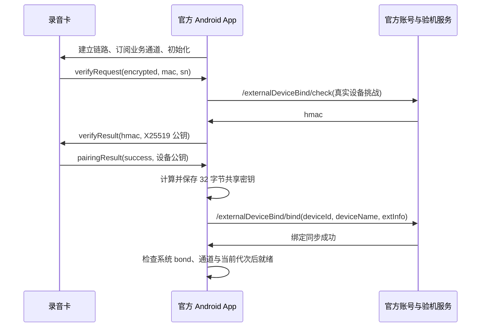

# SunMate 1.0.15+16：已验证的 App 账号渠道

## 本版改变

短信和登录统一使用 openclaw-service.yoooclaw.com 的 App 渠道 3，沿用本次用户真实验证码登录已成功的请求。此前官网渠道 6 登录成功后，设备接口一直返回 401；本次 App 渠道的登录、profile 和设备列表均为 HTTP 200 / 000000，并唯一匹配目标 SN。未捕获 Android 的完整登录交易，字段的服务接受结果与 APK 静态观察分别记录。

账号设备列表的 extInfo 为对象，但缺少 sharedSecret 字段。因此不能仅凭账号记录宣称旧密钥已经恢复。本版诊断会显示缺失字段数量；重复 SN 的任何一条记录缺少密钥或协议不同时，也不选择另一条覆盖本机身份。

HAL、Telink 协议、ANCS 连接选项、密钥挑战算法、音频和私有 MOSS-ASR / Hermes 端点保持原样。本版未接入或擅自调用首次绑定 /check、/bind 接口；没有在没有真实挑战时请求 HMAC，也没有重置或解绑卡片。

## 手机步骤

1. 关闭 iPhone 上的官方 App 和 SunMate，保持 Android 官方 App 联网，用自己的同一账号正常连接目标卡。不主动解绑或恢复出厂；如官方要求此类操作，先保留提示。
2. 安装新版，确认首页和蓝牙诊断显示 1.0.15+16。退出 Android 官方 App，避免其占用录音卡连接。
3. SunMate 先连接一次目标卡，让设备上报真实 SN；再打开「恢复官方账号设备绑定」，通过自己的手机号和新验证码登录。
4. 若返回具备恢复材料的设备，核对 SN 与当前卡一致，点击「恢复并验证连接」。仅在本轮身份挑战通过且事件/音频通道就绪后显示连接成功。
5. 若账号仍未返回共享密钥，保留账号诊断；不要把密钥、验证码或会话复制到聊天。不应把这一步解释为必须购买 SDK 授权。
6. 连接成功后保持至少两分钟，短按/长按按协议尝试实时录音，结束后检查私有 ASR 结果。记录稳定时长和脱敏蓝牙日志。未经实体操作不能宣布稳定连接与录音已完成。

## 首次连接已还原的业务顺序

这是 APK 中可见的 Android 分支。iOS 原生系统配对/ANCS 属于另一层，Android createBond 不能直接移植到 CoreBluetooth。尚未取得官方 iOS 安装包或完整蓝牙空口记录，不能把 Android 静态顺序当作 iOS 弹窗时序的直接观测。

## 构建与交付核对

- 源码提交 3cfb4a5，main 的 Actions #31（39088682721）全部成功。
- 本地安装包：build_output/SunMate-1.0.15+16.ipa，8,508,695 字节。
- SHA-256：3916fe1722d2957b9bc796ff90dc9f696f4aae048b9e6c282e450b45f31c9865。
- Info.plist 为 1.0.15 / Build 16；Runner 中 Keychain 插件注册存在，flutter_blue_plus_darwin 框架中 RequiresANCS、ANCS 授权回调和诊断字段存在。
- 包仍需按原方式自签名安装；上述构建核验不能代替实体 BLE 鉴权和录音结果。
